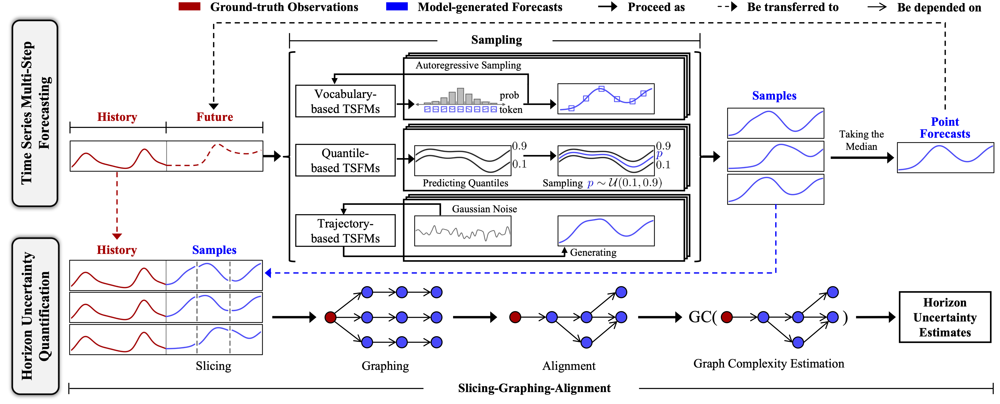

# SGA

Code for **SGA: Uncertainty Quantification for Multi-Step Forecasting in Time Series Foundation Models**.

Xin-Yu Hu, Shuang Liang, Cheng Feng, and Shao-Qun Zhang · [Paper](https://arxiv.org/abs/2609.28582)

SGA (Slicing-Graphing-Alignment) samples forecast trajectories, splits them into slices, and merges similar slices using DTW. It measures horizon uncertainty through the complexity of the resulting graph.



## Getting Started

```bash
git clone https://github.com/zhangsq-nju/SGA.git
cd SGA
```

Use Python 3.12; an NVIDIA GPU is recommended. Run all commands from the repository root.

```bash
python3.12 -m venv .venv
source .venv/bin/activate
pip install -r requirements.txt
```

The pinned dependencies include PyTorch 2.9.1, Chronos 2.2.2, Transformers 4.57.6, TimesFM 2.0.1, and Aurora 0.2.0. The paper experiments used four NVIDIA RTX 5090 GPUs (32 GB each).

### Models and Data

The first run downloads the selected model and dataset. Supported model IDs are:

| Family | Hugging Face model ID |
| --- | --- |
| Chronos-T5 | `amazon/chronos-t5-tiny`, `amazon/chronos-t5-mini`, `amazon/chronos-t5-small`, `amazon/chronos-t5-base`, `amazon/chronos-t5-large` |
| Chronos-2 | `autogluon/chronos-2-small`, `amazon/chronos-2` |
| TimesFM-2.5 | `google/timesfm-2.5-200m-pytorch` |
| Timer-S1 | `bytedance-research/Timer-S1` |
| Sundial | `thuml/sundial-base-128m` |
| Aurora | `DecisionIntelligence/Aurora` |

We use 27 datasets from Chronos Benchmark II.

## Running Experiments

The entry point is `run.py`. It uses [Hydra](https://hydra.cc/) for command-line configuration. All datasets share `config/graph_cfg/default.yaml` and `config/estimators/default.yaml`; forecasting settings are in `config/inference/`.

### 1. Basic Usage

```bash
python run.py
```

By default, this will:

* Use **Chronos-T5-Tiny** on **NN5 Daily** with **20 forecast samples per series**.
* Use **4-step slices**, a **DTW threshold coefficient of 0.25**, and **alpha = 0.1** with mean entropy node scores.
* Evaluate uncertainty against MASE and save results in a timestamped directory under `output/`.

### 2. Overriding Parameters

Each command below is an independent example.

```bash
# Switch the model and dataset.
python run.py model_name=amazon/chronos-2 inference=weather

# Set the experiment directory and result filename; enable bootstrap statistics.
python run.py exp_name=experiment result_name=sga need_std=True

# Generate 30 trajectories per series.
python run.py exp_name=k30 inference.multiple_cfg.num_samples=30
```

### 3. Paper Experiments

Evaluate all 11 models on the 27 datasets:

```bash
python run.py -m exp_name=main result_name=sga need_std=True \
  model_name=amazon/chronos-t5-tiny,amazon/chronos-t5-mini,amazon/chronos-t5-small,amazon/chronos-t5-base,amazon/chronos-t5-large,autogluon/chronos-2-small,amazon/chronos-2,google/timesfm-2.5-200m-pytorch,bytedance-research/Timer-S1,thuml/sundial-base-128m,DecisionIntelligence/Aurora \
  inference=australian_electricity,car_parts,cif_2016,covid_deaths,dominick,ercot,ett_15min,ett_hourly,exchange_rate,fred_md,hospital,m1_monthly,m1_quarterly,m1_yearly,m3_monthly,m3_quarterly,m3_yearly,m4_quarterly,m4_yearly,m5,nn5_daily,nn5_weekly,tourism_monthly,tourism_quarterly,tourism_yearly,traffic,weather
```

Hydra runs these jobs sequentially by default.

## Configuration Parameters

| Parameter | Default | Description |
| --- | --- | --- |
| `exp_name` | Timestamp | Experiment directory name. |
| `result_name` | Timestamp | Result filename suffix. |
| `model_name` | `amazon/chronos-t5-tiny` | Hugging Face model ID. |
| `inference` | `nn5_daily` | Dataset configuration. |
| `graph_cfg`, `estimators` | `default` | Shared graph and scoring configurations. |
| `batch_size` | `64` | Number of series per inference batch. |
| `must_inference_once`, `must_inference_multiple`, `must_construct_graph` | `False` | Regenerate the corresponding intermediate results. |
| `need_std` | `False` | Compute bootstrap NEAURC standard deviation. |

## Outputs

Running `python run.py exp_name=example` saves:

```text
output/example/nn5_daily/amazon/chronos-t5-tiny/
  response_data.jsonl          # Point forecasts, targets, and contexts
  responses_data.jsonl         # Sampled trajectories and probability statistics
  series_metadata.jsonl        # Frequency and seasonal-error scale
  same-time_dtw/g_data_*.jsonl # Merged forecast graphs
  results_<timestamp>.tsv      # Evaluation metrics
```

`NEAURC` is lower-is-better. `AURC` and `EAURC` are also lower-is-better, while `Spearman` is higher-is-better. `MASE` is the average forecast error, and `Mean_Uncertainty` is the average SGA score.

The method label is `SGA`. With `need_std=True`, `NEAURC_STD` contains the bootstrap standard deviation.

The TSV files use raw scores; the paper reports NEAURC on a ×100 scale.

## Citation

If you use SGA in your research, please cite our [paper](https://arxiv.org/abs/2609.28582).

```bibtex
@article{hu2026sga,
  author  = {Xin{-}Yu Hu and
             Shuang Liang and
             Cheng Feng and
             Shao{-}Qun Zhang},
  title   = {{SGA}: Uncertainty Quantification for Multi-Step Forecasting
             in Time Series Foundation Models},
  journal = {arXiv preprint arXiv:2609.28582},
  year    = {2026}
}
```
